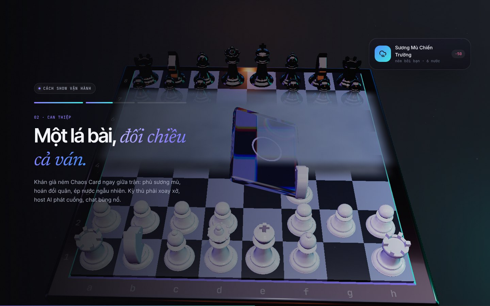
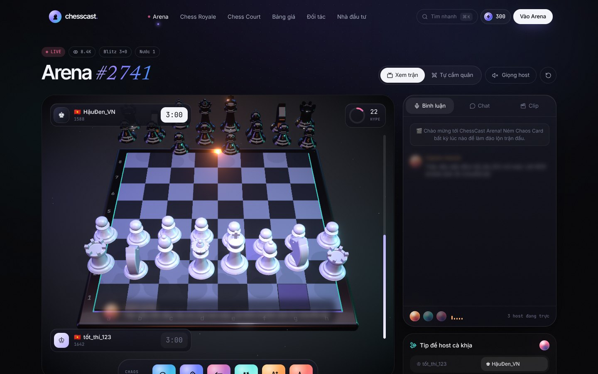
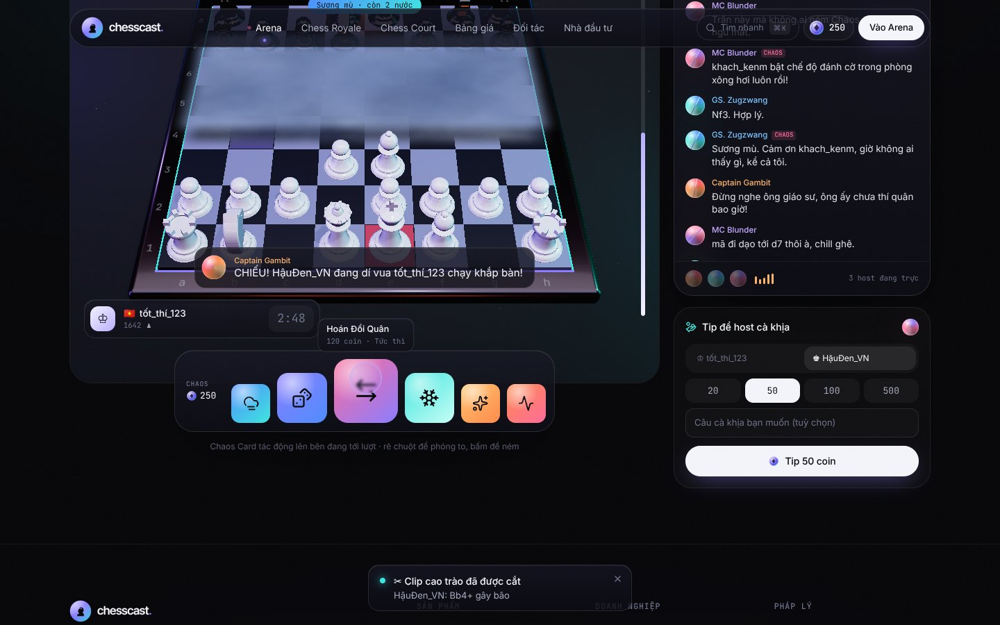

# ChessCast

> Mọi ván cờ đều xứng đáng một sân khấu.

Website hoàn chỉnh cho ChessCast: trang chủ 3D, sản phẩm Arena chạy được thật, các chế độ Chess Royale / Chess Court, bảng giá và luồng thanh toán, trang B2B và trang nhà đầu tư.

**Ngôn ngữ thiết kế “Aurora Noir”:** nền đen sâu với cực quang tím–xanh, kính mờ, quân cờ ngọc trai ánh xà cừ & obsidian, chữ Inter Tight kết hợp Newsreader Italic, nhãn JetBrains Mono.

## Ảnh giao diện

| Hero — Vua kính khúc xạ | Kể chuyện khi cuộn — lá bài kính + sương mù |
| --- | --- |
|  |  |
| **Arena live** | **Dock Chaos Cards phóng to kiểu macOS** |
|  |  |

Toàn bộ ảnh (desktop + mobile) nằm trong [`docs/screenshots/`](docs/screenshots).

## Tính năng

| Trang | Nội dung |
| --- | --- |
| `/` | Hero 3D: quân Vua bằng kính khúc xạ trên vầng hào quang, vòng quân ngọc trai/obsidian quay quanh, tấm kính trôi nổi, nền cực quang chuyển động, thẻ kính bay theo chuột. Dải trận đang phát (bàn cờ mini chạy thật). Phần kể chuyện cuộn ghim 3 chương trên cảnh 3D thứ hai: quả cầu host → lá bài kính rơi + sương mù → khung clip 9:16. Đoạn tuyên ngôn sáng dần theo cuộn, bento tính năng có demo sống, quạt bài Chaos, phòng thu giọng host, bảng giá, lời mời cuối. |
| `/live` | **Arena** dạng studio: bàn cờ 3D xoay được, 2 bot đánh thật (engine minimax), 3 host AI bình luận theo cá tính (có giọng đọc), dock 6 Chaos Cards phóng to khi rê chuột và tác động thật lên ván cờ, vòng đo hype, tip để host “cà khịa”, chat, tự động cắt clip cao trào. Chế độ **Tự cầm quân** để người dùng chơi với bot. |
| `/royale` | Chess Royale: đếm ngược mùa giải, giữ chỗ, đấu trường tròn 100 người co dần vào tâm qua từng vòng loại. |
| `/court` | Chess Court: danh sách vụ án, phiên toà dạng hội thoại giữa AI công tố và AI bào chữa, đồng hồ phán quyết, bồi thẩm đoàn bỏ phiếu (thưởng coin). |
| `/pricing` | Gói thành viên (Khán Giả / Fan Pro / Chaos Lord, tháng–năm), gói Chaos Coins, bảng giá Chaos Cards, FAQ. |
| `/partners` | B2B: tài trợ giải đấu, License/API (code mẫu, webhook), form liên hệ. |
| `/investors` | Thị trường TAM/SAM/SOM, 5 nguồn thu, lộ trình, phân bổ vốn, đội ngũ, form nhận pitch deck. |

Kèm theo: bảng lệnh ⌘K, thanh điều hướng nổi dạng viên thuốc, ví coin nổi, modal thanh toán, toast, màn chào, chuyển trang mờ–rõ, con trỏ tuỳ biến, cuộn mượt Lenis, nút từ tính, card sáng theo chuột, viền gradient chạy.

## Công nghệ

- **Next.js 16** (App Router, Turbopack) · **React 19** · **TypeScript**
- **Three.js + React Three Fiber + Drei + Postprocessing** (bloom, vignette, môi trường ánh sáng tự dựng, không tải HDR ngoài)
- **Motion** (Framer Motion) cho animation/transition · **Lenis** cho cuộn mượt
- **Tailwind CSS v4** · **Zustand** (ví, trạng thái UI) · **chess.js** (luật cờ)
- **Stripe Checkout** (thanh toán) · **Claude API** (bình luận AI thật, tuỳ chọn) · **Resend** (email form, tuỳ chọn)

## Chạy trên máy

```bash
npm install
```

```bash
npm run dev
```

Mở http://localhost:3000. Không cần biến môi trường nào để chạy: thanh toán tự chuyển sang **chế độ demo**, bình luận dùng bộ câu dựng sẵn theo cá tính từng host.

Build production:

```bash
npm run build && npm start
```

## Biến môi trường

Sao chép `.env.example` thành `.env.local` rồi điền:

| Biến | Bắt buộc? | Dùng cho |
| --- | --- | --- |
| `STRIPE_SECRET_KEY` | Để nhận tiền thật | Tạo phiên Stripe Checkout (VND). Trống = chế độ demo. |
| `STRIPE_WEBHOOK_SECRET` | Khi bật webhook | Xác thực `POST /api/stripe/webhook`. |
| `NEXT_PUBLIC_SITE_URL` | Khi deploy | URL gốc để Stripe chuyển hướng về. |
| `ANTHROPIC_API_KEY` | Tuỳ chọn | Bình luận AI thật trong Arena (`/api/commentary`). |
| `RESEND_API_KEY`, `CONTACT_TO_EMAIL` | Tuỳ chọn | Gửi email từ form liên hệ / đăng ký. Trống = chỉ ghi log. |

## Trước khi ra mắt chính thức

- **Cổng thanh toán**: điền khóa Stripe (hoặc thay bằng cổng nội địa), cấu hình webhook tới `/api/stripe/webhook`.
- **Cơ sở dữ liệu & tài khoản**: ví coin hiện lưu trên trình duyệt (`localStorage`) để demo trọn luồng. Bản production cần đăng nhập + database để cộng coin từ webhook phía server (chỗ cần nối đã đánh dấu `TODO(production)`).
- **Nội dung cần xác nhận**: số liệu thị trường (đang ghi rõ là ước tính), tên/thông tin đội ngũ, quy mô vòng gọi vốn, email liên hệ trong `src/lib/site.ts`, giá trong `src/lib/catalog.ts`.

## Cấu trúc

```
src/
  app/                 # các route + API (checkout, webhook, commentary, contact, waitlist)
  components/
    three/             # bàn cờ 3D, quân cờ procedural, ánh sáng, hero scene
    arena/             # logic + UI trang Live
    home/              # các section trang chủ
    commerce/          # ví, thanh toán, gói giá
    royale/ court/ partners/ investors/ pricing/
    ui/                # nút từ tính, tilt, holo card, reveal, cursor…
  lib/
    catalog.ts         # nguồn duy nhất cho giá, gói, Chaos Cards
    hosts.ts           # 3 host AI + bộ sinh bình luận
    chess/             # engine bot, theo dõi quân, hiệu ứng Chaos
    store.ts           # ví & UI (Zustand)
```

Mọi nguồn thu là cơ chế giải trí ảo — coin không quy đổi thành tiền và không dùng để cá cược kết quả trận đấu.
