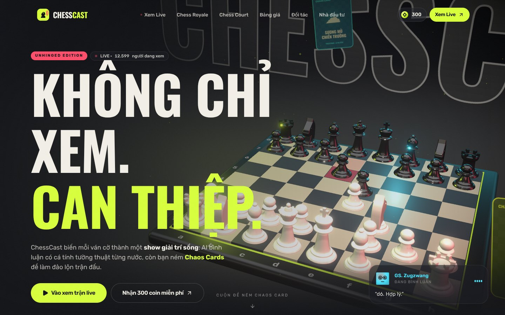
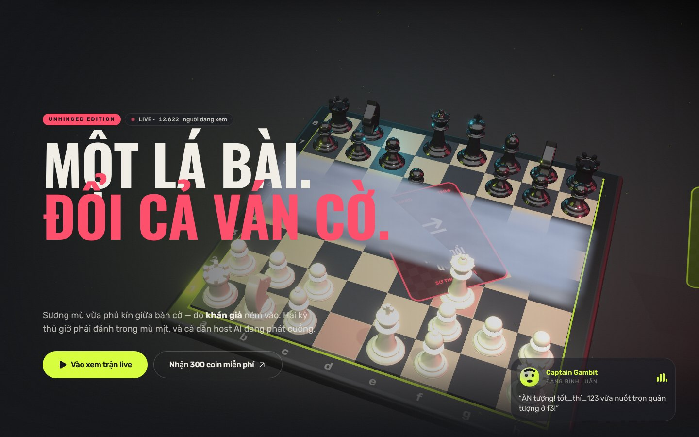
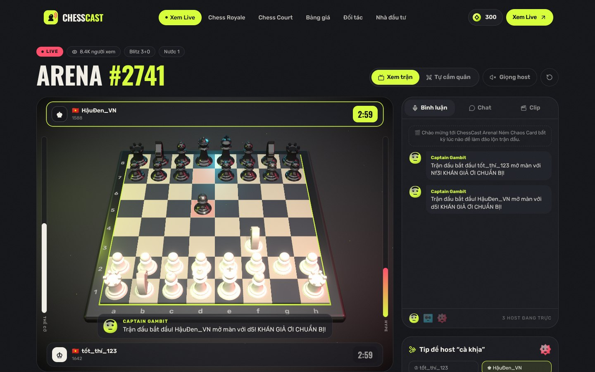
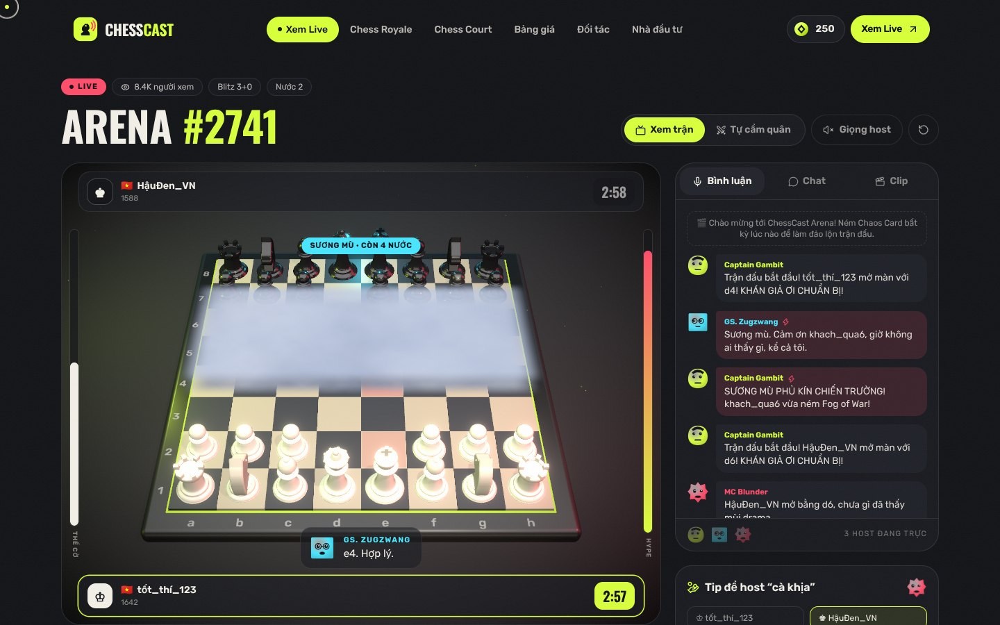

# ChessCast — Unhinged Edition

> Biến mỗi ván cờ thành một show giải trí sống — nơi khán giả không chỉ xem, mà **can thiệp** vào trận đấu.

Website hoàn chỉnh cho ChessCast, dựng từ pitch deck vòng hạt giống: trang chủ 3D, sản phẩm Arena chạy được thật, các chế độ Chess Royale / Chess Court, bảng giá và luồng thanh toán, trang B2B và trang nhà đầu tư.

## Ảnh giao diện

| Trang chủ — hero 3D | Cuộn: Chaos Card + sương mù |
| --- | --- |
|  |  |
| **Arena live** | **Ném “Sương mù chiến trường”** |
|  |  |

Toàn bộ ảnh (desktop + mobile) nằm trong [`docs/screenshots/`](docs/screenshots).

## Tính năng

| Trang | Nội dung |
| --- | --- |
| `/` | Hero 3D (React Three Fiber): bàn cờ bóng bẩy tự diễn ván “Opera”, camera bay theo cuộn chuột, lá Chaos Card lao xuống bàn cờ và phủ sương mù. Các section cuộn ghim: 3 xu hướng hội tụ, 4 trụ cột cuộn ngang, bộ bài holographic, 3 host AI, vòng lặp viral, bảng giá, so sánh đối thủ. |
| `/live` | **Arena**: bàn cờ 3D xoay được, 2 bot đánh thật (engine minimax), 3 host AI bình luận theo cá tính (có giọng đọc), 6 Chaos Cards tác động thật lên ván cờ (sương mù, hoán đổi quân, nước ngẫu nhiên, trừ giờ, đèn sân khấu, động đất), tip để host “cà khịa”, chat, tự động cắt clip cao trào. Chế độ **Tự cầm quân** để người dùng chơi với bot. |
| `/royale` | Chess Royale: đếm ngược mùa giải, giữ chỗ, mô phỏng lưới đấu 100 người nổ từng vòng. |
| `/court` | Chess Court: hồ sơ vụ án, AI công tố, bồi thẩm đoàn khán giả bỏ phiếu (thưởng coin). |
| `/pricing` | Gói thành viên (Khán Giả / Fan Pro / Chaos Lord, tháng–năm), gói Chaos Coins, bảng giá Chaos Cards, FAQ. |
| `/partners` | B2B: tài trợ giải đấu, License/API (code mẫu, webhook), form liên hệ. |
| `/investors` | Thị trường TAM/SAM/SOM, 5 nguồn thu, lộ trình, phân bổ vốn, đội ngũ, form nhận pitch deck. |

Kèm theo: ví coin, lịch sử giao dịch, clip đã lưu (drawer), modal thanh toán, toast, preloader, chuyển trang dạng màn trập, con trỏ tùy biến, cuộn mượt Lenis, nút từ tính, thẻ nghiêng 3D, foil holographic.

## Công nghệ

- **Next.js 16** (App Router, Turbopack) · **React 19** · **TypeScript**
- **Three.js + React Three Fiber + Drei + Postprocessing** (bloom, vignette, môi trường ánh sáng tự dựng, không tải HDR ngoài)
- **Motion** (Framer Motion) cho animation/transition · **Lenis** cho cuộn mượt
- **Tailwind CSS v4** · **Zustand** (ví, trạng thái UI) · **chess.js** (luật cờ)
- **Stripe Checkout** (thanh toán) · **Claude API** (bình luận AI thật, tuỳ chọn) · **Resend** (email form, tuỳ chọn)

## Chạy trên máy

```bash
npm install
```

```bash
npm run dev
```

Mở http://localhost:3000. Không cần biến môi trường nào để chạy: thanh toán tự chuyển sang **chế độ demo**, bình luận dùng bộ câu dựng sẵn theo cá tính từng host.

Build production:

```bash
npm run build && npm start
```

## Biến môi trường

Sao chép `.env.example` thành `.env.local` rồi điền:

| Biến | Bắt buộc? | Dùng cho |
| --- | --- | --- |
| `STRIPE_SECRET_KEY` | Để nhận tiền thật | Tạo phiên Stripe Checkout (VND). Trống = chế độ demo. |
| `STRIPE_WEBHOOK_SECRET` | Khi bật webhook | Xác thực `POST /api/stripe/webhook`. |
| `NEXT_PUBLIC_SITE_URL` | Khi deploy | URL gốc để Stripe chuyển hướng về. |
| `ANTHROPIC_API_KEY` | Tuỳ chọn | Bình luận AI thật trong Arena (`/api/commentary`). |
| `RESEND_API_KEY`, `CONTACT_TO_EMAIL` | Tuỳ chọn | Gửi email từ form liên hệ / đăng ký. Trống = chỉ ghi log. |

## Trước khi ra mắt chính thức

- **Cổng thanh toán**: điền khóa Stripe (hoặc thay bằng cổng nội địa), cấu hình webhook tới `/api/stripe/webhook`.
- **Cơ sở dữ liệu & tài khoản**: ví coin hiện lưu trên trình duyệt (`localStorage`) để demo trọn luồng. Bản production cần đăng nhập + database để cộng coin từ webhook phía server (chỗ cần nối đã đánh dấu `TODO(production)`).
- **Nội dung cần xác nhận**: số liệu thị trường (đang ghi rõ là ước tính), tên/thông tin đội ngũ, quy mô vòng gọi vốn, email liên hệ trong `src/lib/site.ts`, giá trong `src/lib/catalog.ts`.

## Cấu trúc

```
src/
  app/                 # các route + API (checkout, webhook, commentary, contact, waitlist)
  components/
    three/             # bàn cờ 3D, quân cờ procedural, ánh sáng, hero scene
    arena/             # logic + UI trang Live
    home/              # các section trang chủ
    commerce/          # ví, thanh toán, gói giá
    royale/ court/ partners/ investors/ pricing/
    ui/                # nút từ tính, tilt, holo card, reveal, cursor…
  lib/
    catalog.ts         # nguồn duy nhất cho giá, gói, Chaos Cards
    hosts.ts           # 3 host AI + bộ sinh bình luận
    chess/             # engine bot, theo dõi quân, hiệu ứng Chaos
    store.ts           # ví & UI (Zustand)
```

Mọi nguồn thu là cơ chế giải trí ảo — coin không quy đổi thành tiền và không dùng để cá cược kết quả trận đấu.
