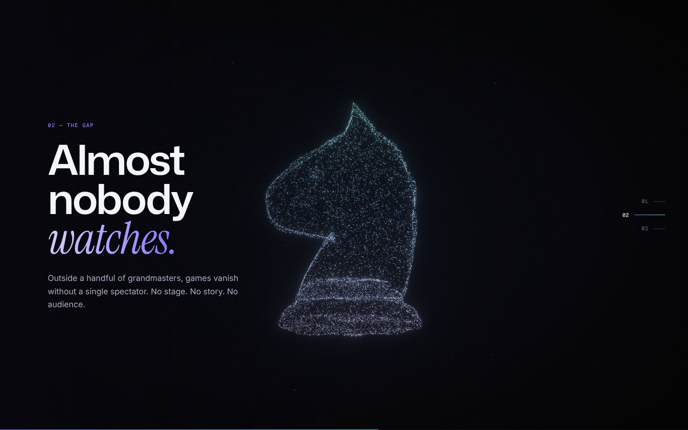
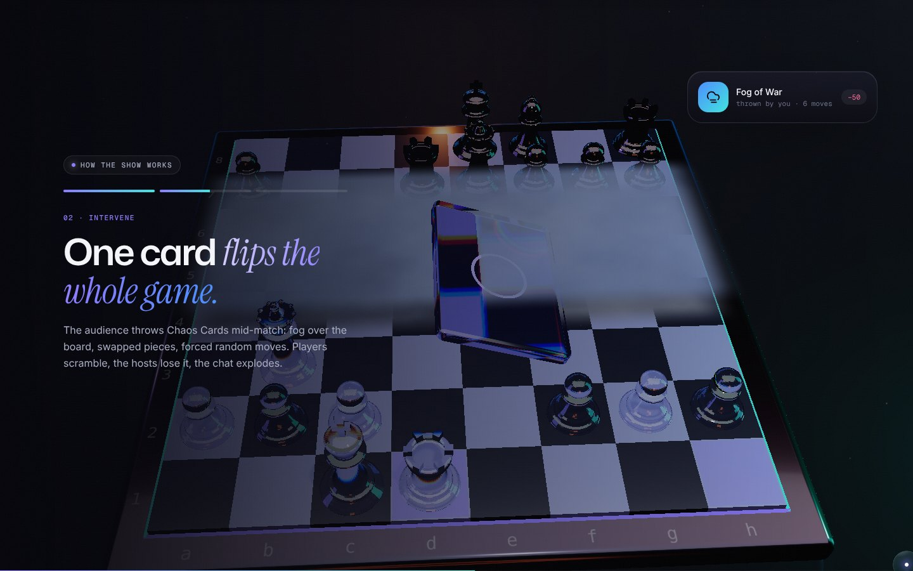
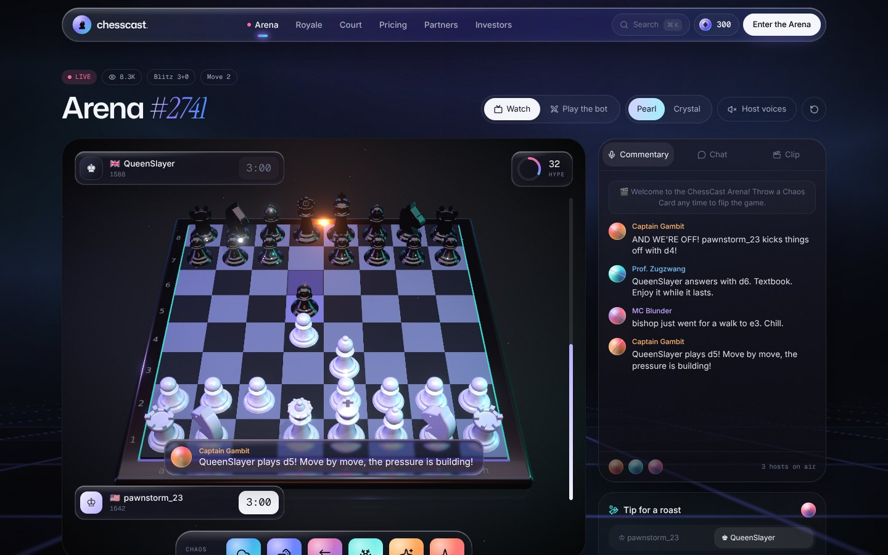

# ChessCast

> Every game deserves a stage.

The complete website for ChessCast — AI-hosted live chess entertainment. It includes a real-time 3D homepage, a working **Arena** product, the Chess Royale and Chess Court modes, pricing with a checkout flow, a partners/API page and an investors page. The whole interface is in English and prices are in USD.

**Design language — “Aurora Noir v3”:** a deep void-black stage lit by violet–cyan aurora, real refracting **Liquid Glass** UI, crystal and pearl chess pieces, GPU particle sculptures and cinematic post-processing. Type is Mona Sans (variable weight *and* width) with Instrument Serif italics and Geist Mono labels.

## Screenshots

| Hero — refracting glass king, depth of field | Manifesto — 16,000-particle knight |
| --- | --- |
|  |  |
| **Scroll story — crystal board, Fog of War** | **Arena — live studio** |
|  |  |

Every screenshot (desktop and mobile) is in [`docs/screenshots/`](docs/screenshots).

## Graphics

- **Liquid Glass** — real backdrop refraction in Chromium: every glass element (navbar, Arena HUD, hero cards, Chaos dock) builds its own SVG displacement map from its exact size and corner radius, with RGB dispersion along the rim. Other browsers get a frosted-glass fallback.
- **Hero** — a king in `MeshTransmissionMaterial` (refraction, chromatic aberration, iridescence) on a glowing halo, orbiting pearl and crystal pieces, floating glass shards, bloom + depth of field + vignette, mouse parallax and scroll choreography.
- **Ambient WebGL** — a full-screen GLSL aurora (simplex-noise flow fields) behind the whole site.
- **Manifesto** — 16,000 GPU particles sampled from the piece meshes (`MeshSurfaceSampler`) morph nebula → king → knight → queen as you scroll, scattering through a simplex-noise flow field between shapes.
- **Scroll story** — a pinned three-act 3D scene: host orbs, a glass Chaos Card dropping onto a crystal board with Fog of War, a mirror-reflective floor.
- **Voices** — a shader-driven voice orb per AI host. **Final CTA** — a hyperspace warp shader.
- **Type & motion** — variable-font proximity headlines, text scramble, scroll-velocity marquees, holographic foil cards, magnetic buttons, Lenis smooth scrolling, blur-to-sharp transitions.
- **Performance** — `PerformanceMonitor` drops resolution and heavy effects on slow GPUs; pages pause rendering when off-screen. Append `?hq` to force the high-quality path or `?lq` to force the light path.

## Pages

| Route | What's there |
| --- | --- |
| `/` | Hero, manifesto particle morph, pinned 3D story, live games rail (real mini boards), feature bento with live demos, Chaos Card deck, host voice studio, pricing, final call to action. |
| `/live` | **Arena** studio: orbitable 3D board (pearl or crystal piece set), two bots playing real chess (minimax engine), three AI hosts with distinct personalities and speech, a Liquid Glass dock of six Chaos Cards that really change the game, hype meter, tips for roasts, chat, automatic highlight clips, and **Play the bot** mode. |
| `/royale` | Chess Royale: season countdown, reserve a seat, a 100-player circular arena that shrinks round by round. |
| `/court` | Chess Court: case files, a trial dialogue between an AI prosecutor and defender, verdict timer, jury voting with coin rewards. |
| `/pricing` | Memberships (Spectator / Fan Pro / Chaos Lord, monthly–yearly), Chaos Coin packs, per-card prices, FAQ. |
| `/partners` | B2B: tournament sponsorship, License / API (code sample, live webhook stream), contact form. |
| `/investors` | Seed round card, thesis, TAM/SAM/SOM rings, five revenue streams, roadmap, use-of-funds donut, team, pitch-deck request form. |

Also: ⌘K command menu, floating Liquid Glass navbar, coin wallet drawer, checkout modal, toasts, intro preloader, custom lens cursor.

## Stack

- **Next.js 16** (App Router, Turbopack) · **React 19** · **TypeScript**
- **Three.js + React Three Fiber + Drei + Postprocessing**, custom GLSL shaders (lighting is built in code, no external HDR downloads)
- **Motion** for animation and transitions · **Lenis** for smooth scrolling
- **Tailwind CSS v4** · **Zustand** (wallet, UI state) · **chess.js** (rules)
- **Stripe Checkout** (payments, USD) · **Claude API** (optional live AI commentary) · **Resend** (optional form email)

## Run locally

```bash
npm install
```

```bash
npm run dev
```

Open http://localhost:3000. No environment variables are needed: checkout falls back to **demo mode** and commentary uses the built-in, personality-driven lines.

Production build:

```bash
npm run build && npm start
```

## Environment variables

Copy `.env.example` to `.env.local` and fill in:

| Variable | Required? | Used for |
| --- | --- | --- |
| `STRIPE_SECRET_KEY` | To take real payments | Creates Stripe Checkout sessions (USD). Empty = demo mode. |
| `STRIPE_WEBHOOK_SECRET` | When the webhook is enabled | Verifies `POST /api/stripe/webhook`. |
| `NEXT_PUBLIC_SITE_URL` | When deployed | Base URL Stripe redirects back to. |
| `ANTHROPIC_API_KEY` | Optional | Live AI commentary in the Arena (`/api/commentary`). |
| `RESEND_API_KEY`, `CONTACT_TO_EMAIL` | Optional | Sends contact / waitlist emails. Empty = log only. |
| `NEXT_PUBLIC_SUPABASE_URL`, `NEXT_PUBLIC_SUPABASE_PUBLISHABLE_KEY` | Optional | Sign-in and a server-side wallet. Empty = wallet stays in the browser. |
| `SUPABASE_SECRET_KEY` | With Supabase | Server only. Lets the Stripe webhook credit coins. |

## Deploy (Cloudflare Workers + Supabase)

The app deploys to Cloudflare Workers through `@opennextjs/cloudflare` (`npm run preview`, `npm run deploy`). The database schema is in `supabase/migrations/`. Step-by-step setup: [`docs/DEPLOY.md`](docs/DEPLOY.md).

## Before going live

- **Payments**: add your Stripe keys and point a webhook at `/api/stripe/webhook`.
- **Accounts & database**: with Supabase configured, signed-in purchases are credited server-side by the Stripe webhook. Spending coins in the Arena and Court is still deducted in the browser only.
- **Content to confirm**: market figures (labelled as estimates), team details, round size, contact emails in `src/lib/site.ts`, prices in `src/lib/catalog.ts`.

## Structure

```
src/
  app/                 # routes + API (checkout, webhook, commentary, contact, waitlist)
  components/
    gl/                # GLSL: ambient aurora, particle morph, voice orb, warp
    three/             # 3D board, procedural pieces, lighting, hero & story scenes
    arena/             # Live page logic + UI
    home/              # homepage sections
    commerce/          # wallet, checkout, plans
    royale/ court/ partners/ investors/ pricing/
    ui/                # Liquid Glass, proximity text, scramble, marquee, cursor, cards…
  lib/
    catalog.ts         # single source of truth for prices, plans, Chaos Cards
    hosts.ts           # the three AI hosts + commentary generator
    chess/             # bot engine, piece tracking, Chaos effects
    store.ts           # wallet & UI (Zustand)
```

Every revenue stream is virtual entertainment — coins can't be exchanged for money and are never used to bet on the outcome of a game.
